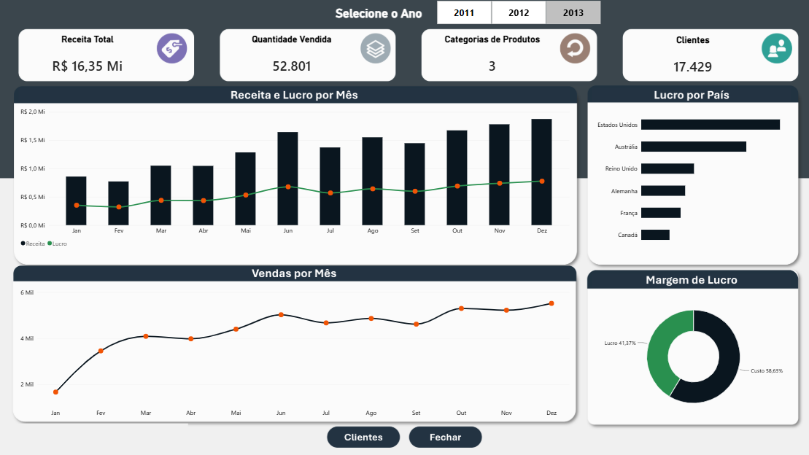
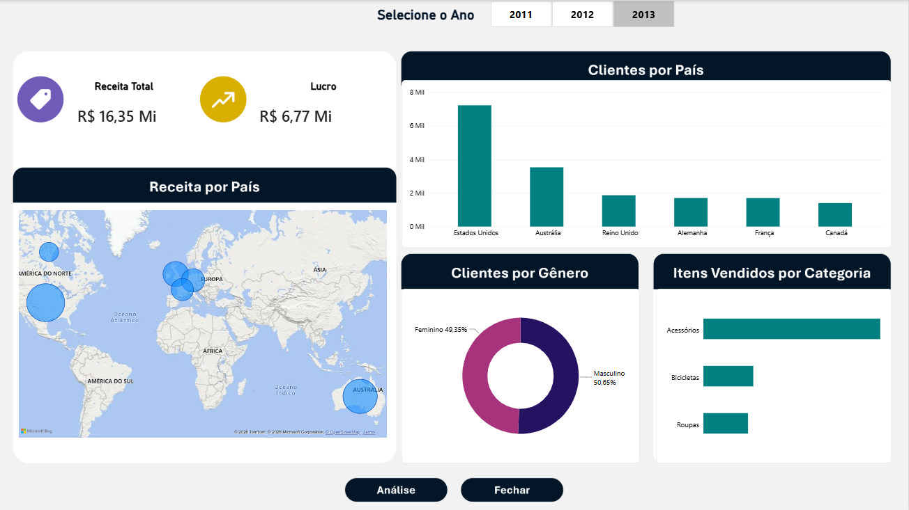

# Vendas Online da Adventure Works Cycles (2011–2013)

Análise das vendas pela internet da Adventure Works Cycles, do SQL Server ao Power BI: uma view no banco entrega os dados prontos e o dashboard responde onde, o que e para quem a empresa vende, com todos os números validados contra o banco.


*Página "Análise" com 2013 selecionado.*


*Página "Clientes" com 2013 selecionado.*

## Problema

A Adventure Works Cycles (empresa fictícia da Microsoft) vende bicicletas, acessórios e roupas pela internet. A pergunta foi: **como evoluíram receita, lucro e clientes entre 2011 e 2013, e de onde vêm esses resultados — de quais países, categorias e perfis de cliente?**

## Fluxo

```
banco (SQL Server) → view → Power BI (modelo + DAX) → visualização → validação → interpretação
```

| Etapa | O que foi feito |
|---|---|
| Dados brutos | `FactInternetSales` com produto, subcategoria, categoria, cliente e geografia |
| Transformação (SQL) | View `dbo.vendas_online_da_adventure_works_cycles_2011_2013`: junções em cadeia, recorte de período e tradução para português |
| Modelo (Power BI) | Fato `vendas` ligada à tabela `Calendário` (marcada como tabela de datas); data/hora automática desligada |
| Indicadores (DAX) | 6 medidas, todas usadas nos visuais |
| Visualização | Capa, página Análise e página Clientes, com filtro de ano sincronizado entre as páginas |
| Validação | Totais e números por ano conferidos com consultas SQL na view, até o centavo |

## Decisões e regras de negócio

- **Recorte 2011–2013.** A tabela de vendas vai de 29/12/2010 a 28/01/2014. As pontas incompletas ficaram de fora para que a comparação entre anos seja justa.
- **Tradução na origem.** Categorias e países chegam em português direto da view (`CASE` no SQL), sem passos extras no Power Query.
- **Um ano por vez.** A segmentação de ano é de seleção única e sincronizada nas duas páginas, para os gráficos mensais nunca somarem anos diferentes sem avisar.
- **Visuais só com medidas.** As colunas de valores ficam ocultas; todo visual usa uma medida ou a `Calendário`.

## Indicadores

| Medida | DAX |
|---|---|
| Receita Total | `SUM ( vendas[Receita Venda] )` |
| Lucro Total | `SUM ( vendas[Lucro na Venda] )` |
| Custo Total | `SUM ( vendas[Custo na Venda] )` |
| Quantidade Vendida | `SUM ( vendas[Qtd.Vendida] )` |
| Clientes | `DISTINCTCOUNT ( vendas[ID Cliente] )` |
| Total Categorias | `DISTINCTCOUNT ( vendas[Categoria do Produto] )` |

## Resultados (2011–2013)

| Indicador | Valor |
|---|---|
| Receita | R$ 29.269.561,46 |
| Lucro | R$ 12.037.481,74 (41,1%) |
| Pedidos | 26.774 |
| Clientes | 17.977 |
| Quantidade vendida | 58.414 itens |

| Ano | Receita | Margem | Clientes |
|---|---|---|---|
| 2011 | R$ 7.075.525,93 | 40,2% | 2.216 |
| 2012 | R$ 5.842.485,20 | 41,6% | 3.255 |
| 2013 | R$ 16.351.550,34 | 41,4% | 17.429 |

Validação: 58.414 linhas; receita, lucro, quantidade, clientes e pedidos batem com o SQL no total e por ano.

## Principais achados

1. **Bicicletas sustentam o negócio: 96,6% da receita.** Acessórios e roupas só começaram a ser vendidos online em 28/12/2012 e, mesmo sendo a maioria dos itens vendidos, somam 3,4% da receita.
2. **2013 foi o ano da virada: receita +179,9%.** O salto veio principalmente das bicicletas (de R$ 5,84 Mi para R$ 15,36 Mi). Acessórios e roupas trouxeram muitos clientes novos (de 3.255 para 17.429), mas pouca receita.
3. **Estados Unidos e Austrália somam 62,9% da receita.** A Austrália tem menos da metade dos clientes dos EUA e quase a mesma receita: compras de maior valor.
4. **Canadá: 3º em itens, último em receita** — muitos itens baratos e poucas bicicletas.
5. **Margem estável perto de 41%** nos três anos e em todos os países; acessórios têm a maior margem (62,6%).

### Próximas perguntas

- O que explica a queda de 17,4% da receita em 2012, mesmo com mais clientes?
- Os clientes que entraram em 2013 comprando acessórios voltaram para comprar bicicletas?

## Estrutura do repositório

```
view_vendas_online_da_adventure_works_cycles_2011_2013.sql      view no SQL Server + consultas de conferência
vendas_online_da_adventure_works_cycles_2011_2013.pbip          projeto do Power BI (abrir este arquivo)
vendas_online_da_adventure_works_cycles_2011_2013.SemanticModel/  modelo em TMDL: tabelas, relação, medidas DAX, Power Query
vendas_online_da_adventure_works_cycles_2011_2013.Report/         páginas do relatório em PBIR (JSON)
docs/                                                             prints e documentação completa (Word)
```

## Como reproduzir

1. Restaure o banco **AdventureWorksDW2014** num SQL Server.
2. Rode `view_vendas_online_da_adventure_works_cycles_2011_2013.sql` para criar a view.
3. Abra `vendas_online_da_adventure_works_cycles_2011_2013.pbip` no Power BI Desktop.
4. A consulta aponta para o SQL Server local do autor. Troque pelo nome do seu servidor em **Transformar dados → Configurações da fonte de dados** e atualize.

## Ferramentas

SQL Server (T-SQL, views) · Power BI Desktop (Power Query M, DAX, formato PBIP/TMDL/PBIR) · IA (Claude) como apoio na construção e na validação
